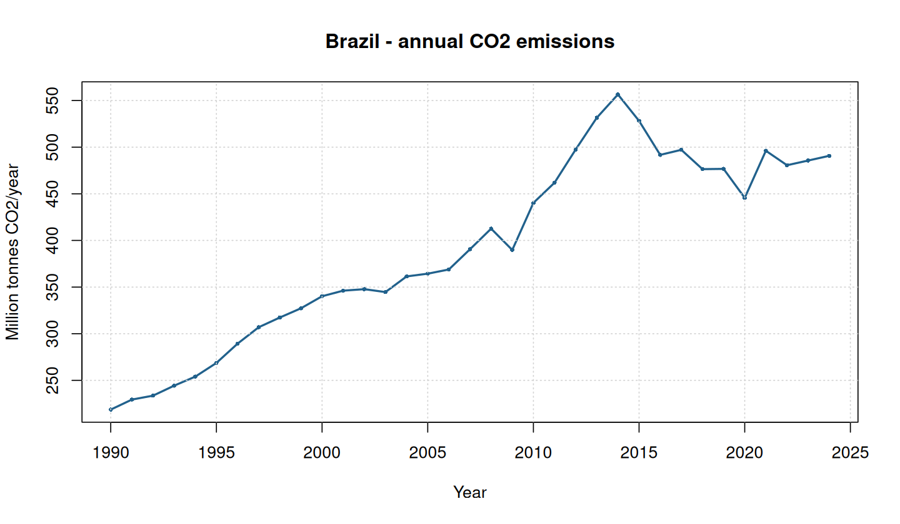
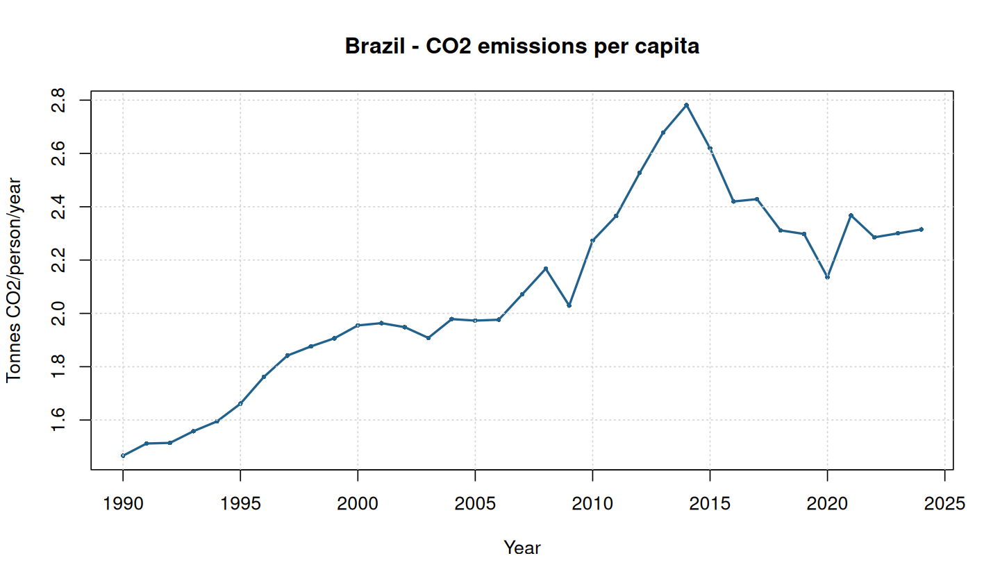
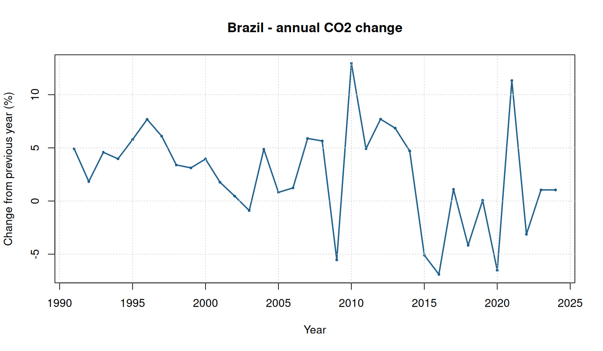

**Student:** Antonio Ellazhar Q. Lizada

**GitHub Username:** AntonioLizada

**Country:** Brazil

**ISO-3 Code:** BRA

**Study Period:** 1990–2024# CO₂ Emissions Analysis: Brazil (BRA)
## 1. Research Question

How have annual CO₂ emissions and CO₂ emissions per capita changed in Brazil from 1990 to 2024?

## 2. Data Source

This project used data from Our World in Data (OWID), specifically the CO₂ and Greenhouse Gas Emissions dataset.

Dataset: https://github.com/owid/co2-data

The selected variables included:
- Year
- Annual CO₂ emissions
- CO₂ emissions per capita

Annual CO₂ emissions are measured in million metric tons, while per-capita emissions are measured in metric tons per person.

## 3. Software and Tools

The following tools were used:
- R
- RStudio
- Git
- GitHub

## 4. Methodology

The analysis was conducted using RStudio. The complete OWID dataset was downloaded and filtered to include only Brazil using its ISO-3 country code, BRA.

The selected data covered the period from 1990 to 2024. The R script generated a country-specific CSV file, three graphs, summary statistics, and yearly percentage changes.

To reproduce the analysis, open the project in RStudio and run:

`source("scripts/analyze_co2.R")`

## 5. Project Files and Outputs

- `data/BRA_co2.csv` – Brazil's CO₂ emissions dataset.
- `scripts/analyze_co2.R` – R script used for the analysis.
- `figures/BRA_annual_co2.png` – Annual CO₂ emissions graph.
- `figures/BRA_per_capita.png` – CO₂ emissions per capita graph.
- `figures/BRA_annual_change.png` – Annual percentage change graph.
- `results/BRA_summary.csv` – Summary statistics.
- `results/BRA_yearly_changes.csv` – Yearly percentage changes.
- `results/session_info.txt` – R session information.

## 6. Graphical Results

### Annual CO₂ Emissions in Brazil

### CO₂ Emissions Per Capita

### Annual Percentage Change in CO₂ Emissions

## 7. Environmental Interpretation

Brazil's annual CO₂ emissions increased from approximately 218.66 million metric tons in 1990 to 490.74 million metric tons in 2024. This represents an overall increase of approximately 124.43% during the study period. The highest emissions were recorded in 2014, reaching approximately 556.53 million metric tons. This indicates that Brazil experienced considerable changes in its annual CO₂ emissions over the 35-year period.

The results show that emissions did not continuously increase every year. Instead, they fluctuated, reaching a peak in 2014 before decreasing and subsequently increasing again toward 2024. These variations suggest that Brazil's emissions changed over time rather than following a consistent upward pattern.

In 2024, Brazil's CO₂ emissions per capita reached approximately 2.31 metric tons per person. This measurement provides a different perspective from total annual emissions because it represents the average emissions per person rather than the country's overall contribution.

These findings are environmentally important because carbon dioxide contributes to global warming and climate change. Changes in emissions can have implications for ecosystems, biodiversity, and natural resources. However, this analysis identifies emission patterns and does not establish the specific causes of the observed increases and decreases.

## 8. Limitations

The analysis focused on national-level CO₂ emissions from the selected Our World in Data variables between 1990 and 2024. It did not examine differences among individual regions or industries within Brazil. The observed trends also do not establish causation, and the analysis focused on CO₂ rather than all greenhouse gases.

## 9. References

- Our World in Data. CO₂ and Greenhouse Gas Emissions Dataset. https://github.com/owid/co2-data
- Our World in Data. CO₂ Emissions. https://ourworldindata.org/co2-emissions
